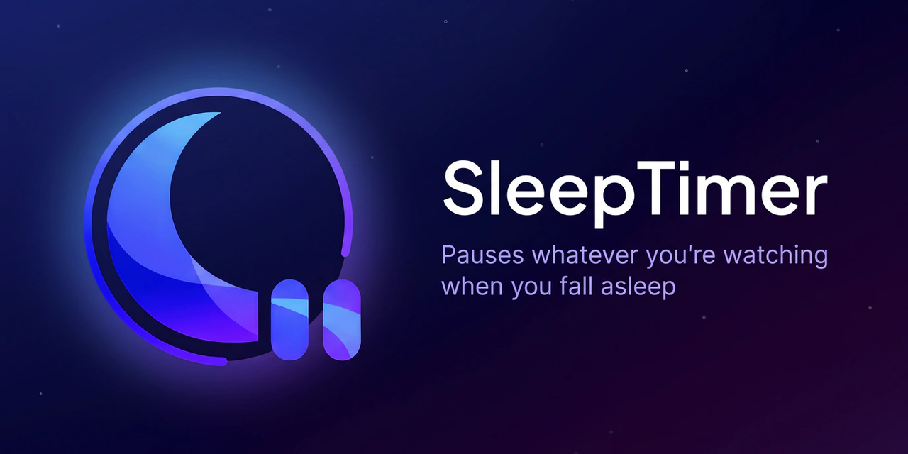

<p align="center"></p>

# Sleep Timer

A tiny macOS menu-bar app that **pauses whatever is playing** after a set time, without putting the Mac to sleep. Built for falling asleep to TV (Infuse, the TV app, streaming in a browser).

## Features

- Presets: 15, 30, 45 min, 1, 1.5, 2 hours
- Countdown in a blue menu-bar pill while a timer runs (e.g. `42m`), plus **Add 15 Minutes** and **Cancel Timer**
- **Pause Now** to pause immediately
- **Launch at Login** toggle
- Menu bar only, no Dock icon. Does no work while idle.

## Build and install

Requires Xcode Command Line Tools (`xcode-select --install`).

```sh
bash build.sh
osascript -e 'quit app "SleepTimer"' 2>/dev/null
rm -rf /Applications/SleepTimer.app && mv SleepTimer.app /Applications/
open /Applications/SleepTimer.app
```

Install to `/Applications` before turning on Launch at Login, since the login item points at the app's current location.

## How the pause works

macOS 15.4+ blocks third-party apps from sending commands to the system Now Playing service (`mediaremoted`) directly. The app launches `/usr/bin/osascript` with a fixed JXA script that sends an explicit **Pause** (not a toggle) through the private `MediaRemote` framework's `MRNowPlayingController`. That works from the system binary without special permissions.

Because this uses a private framework, a macOS update could break it. If `osascript` exits with an error or hangs for 10 seconds, the app posts a notification. There is no fallback: if something is still playing, you'll know.

Every failure is recorded in `~/Library/Logs/SleepTimer.log` with the time, macOS version and the error, so a break after an OS update can be traced later. The top of the menu shows "Pause failed at …"; click it to open the log in Console.

One gap remains: if MediaRemote exits cleanly but pauses nothing, the app can't tell. Use **Pause Now** to check after macOS updates.

Tested on macOS 27 with Infuse.

## Security and resources

- No network, no file I/O, no user input reaches the child process
- Only child process: `/usr/bin/osascript` with a constant script, called by absolute path
- No privacy permissions required
- Ad-hoc signed with the hardened runtime. Not sandboxed (the sandbox would likely block the pause) and not notarized.
- Idle: no timers or polling. While a timer runs: one one-shot timer plus a once-a-minute countdown update with tolerance.

## Files

- `main.swift`: the app
- `build.sh`: builds and signs `SleepTimer.app`
- `AppIcon.icns`, `icon.png`: app icon and its 1024px full-bleed source (generated with Recraft; macOS applies the rounded mask)
- `sleeptimer`: original command-line prototype (`./sleeptimer 45`, `status`, `cancel`, `test`)
